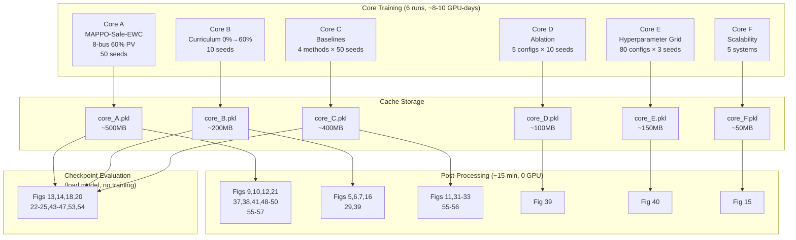

# Merged Pipeline Architecture

## Before (Original) — ~40 GPU-days

```
Fig 9  → train MAPPO-Safe 8bus 60% PV ──┐
Fig 10 → train MAPPO-Safe 8bus 60% PV ──┼── 5 separate runs, SAME config
Fig 21 → train MAPPO-Safe 8bus 60% PV ──┤
Fig 37 → train MAPPO-Safe 8bus 60% PV ──┤
Fig 38 → train MAPPO-Safe 8bus 60% PV ──┘

Fig 5  → train MAPPO-Safe-EWC 8bus 0-60% PV ──┐
Fig 6  → train MAPPO-Safe-EWC 8bus 0-60% PV ──┤
Fig 7  → train MAPPO-Safe-EWC 8bus 0-60% PV ──┤── 4 separate runs, SAME config
Fig 16 → train MAPPO-Safe-EWC 8bus 0-60% PV ──┤
Fig 29 → train MAPPO-Safe-EWC 8bus 0-60% PV ──┘

Fig 12 → train all baselines 50 runs ──┐
Fig 11 → train all baselines 50 runs ──┼── 3 separate runs
Fig 31 → train all baselines 50 runs ──┘

... etc for every figure
```

## After (Merged) — ~8-10 GPU-days

```
┌─────────────────────────────────────────────────────────────────────────────┐
│                           CORE TRAINING (6 runs)                            │
├─────────────────────────────────────────────────────────────────────────────┤
│                                                                             │
│  Core A: MAPPO-Safe-EWC, 8-bus, 60% PV, 50 seeds, 5000 episodes           │
│     └── captures: returns, CTI, lagrange, safety, per-agent, attention     │
│                                                                             │
│  Core B: Curriculum 0%→60% PV, 10 seeds                                    │
│     └── captures: task transitions, forgetting curves, PV sweep evals      │
│                                                                             │
│  Core C: Baselines (4 methods), 50 seeds                                   │
│     └── captures: comparative convergence, final distributions               │
│                                                                             │
│  Core D: Ablation (5 configs), 10 seeds                                    │
│     └── captures: component contribution, marginal gains                     │
│                                                                             │
│  Core E: Hyperparameter grid, 3 seeds × 80 configs                         │
│     └── captures: sensitivity surface, robust region                       │
│                                                                             │
│  Core F: Scalability (5 systems), 1 seed each                              │
│     └── captures: training time scaling, performance vs size               │
│                                                                             │
└─────────────────────────────────────────────────────────────────────────────┘
                                    │
                                    ▼
┌─────────────────────────────────────────────────────────────────────────────┐
│                        POST-PROCESSING (all figures)                        │
├─────────────────────────────────────────────────────────────────────────────┤
│                                                                             │
│  From Core A cache:                                                         │
│    ├── Fig 9   → cti_violation_rates[], lagrange_norms[]                   │
│    ├── Fig 10  → lagrange_norms[]                                          │
│    ├── Fig 12  → global_returns[] (+ Core C for baselines)                  │
│    ├── Fig 21  → safety_activations[]                                      │
│    ├── Fig 37  → per_agent_returns[]                                       │
│    ├── Fig 38  → attention_snapshots{}                                     │
│    ├── Fig 41  → global_returns[] (cumulative steps)                       │
│    ├── Fig 48  → final checkpoint (SHAP)                                  │
│    ├── Fig 49  → final checkpoint (decision boundary)                        │
│    ├── Fig 50  → violation patterns                                       │
│    └── Fig 55-57 → statistical aggregations of all above                   │
│                                                                             │
│  From Core B cache:                                                         │
│    ├── Fig 5   → task_evaluations[PV levels]                               │
│    ├── Fig 6   → task_evaluations[CTI rates]                              │
│    ├── Fig 7   → task_performances matrix                                  │
│    ├── Fig 16  → with_ewc vs without_ewc matrices                          │
│    ├── Fig 29  → EWC visualization                                         │
│    └── Fig 39  → full config performance                                   │
│                                                                             │
│  From Core C cache:                                                         │
│    ├── Fig 11  → final performance ranks                                   │
│    ├── Fig 12  → baseline convergence curves                               │
│    ├── Fig 31  → multi-metric ranking                                      │
│    ├── Fig 32  → effect sizes                                              │
│    ├── Fig 33  → radar chart                                               │
│    └── Fig 55-56 → comparison table, Pareto front                          │
│                                                                             │
│  From Core D cache:                                                         │
│    └── Fig 39  → ablation component bars                                   │
│                                                                             │
│  From Core E cache:                                                         │
│    └── Fig 40  → hyperparameter heatmaps                                   │
│                                                                             │
│  From Core F cache:                                                         │
│    └── Fig 15  → scalability scatter plots                                 │
│                                                                             │
│  Checkpoint Evaluation (no training):                                       │
│    ├── Fig 13  → Core A checkpoint + packet loss                           │
│    ├── Fig 14  → Core A checkpoint + line outages                          │
│    ├── Fig 18  → Core A checkpoint + latency benchmark                     │
│    ├── Fig 20  → Core A checkpoint + Byzantine agents                    │
│    ├── Fig 22  → Core A checkpoint + GNN depth variation                  │
│    ├── Fig 23  → Core A checkpoint + unseen faults                         │
│    ├── Fig 24  → Core A checkpoint + sensor noise                          │
│    ├── Fig 25  → Core A checkpoint + 14-bus transfer                       │
│    ├── Fig 43-47 → Core A checkpoint + protection analysis                 │
│    ├── Fig 53  → Core A checkpoint + compression                           │
│    └── Fig 54  → Core A checkpoint + adversarial attacks                   │
│                                                                             │
└─────────────────────────────────────────────────────────────────────────────┘
```

## Mermaid Diagram



## Cache Key Design

```python
# Content-addressable: same config → same key → cache hit
def cache_key(config: dict) -> str:
    config_str = json.dumps(config, sort_keys=True, default=str)
    return hashlib.sha256(config_str.encode()).hexdigest()[:16]

# Example keys:
# Core A:  {"name":"core_A", "method":"MAPPO-Safe-EWC", "system":"8bus", "pv":0.6, "n_runs":50, ...}
#          → "a3f7e2d9b8c1..." → results/core_cache/a3f7e2d9b8c1.pkl
#
# Core B:  {"name":"core_B", "tasks":[0.0,0.2,0.4,0.6], "n_runs":10, ...}
#          → "b8e1c4f2a5d3..." → results/core_cache/b8e1c4f2a5d3.pkl
```
